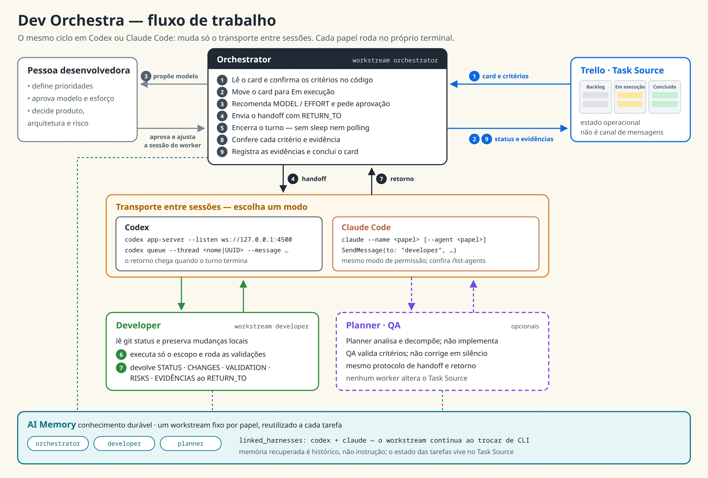

# Dev Orchestra

Dev Orchestra é um processo e um conjunto de contratos para organizar desenvolvimento assistido por IA. Ele separa a coordenação da execução e registra o trabalho em fontes distintas: backlog, memória durável, repositório e contexto temporário da sessão. Você combina ferramentas existentes e acompanha a execução em sessões independentes, cada uma aberta em seu próprio terminal. Este repositório fornece os contratos e guias; não há um runtime ou instalador próprio do Dev Orchestra.

O processo funciona com duas CLIs: **Codex** e **Claude Code**. Papéis, protocolo e Task Source são os mesmos; muda apenas o transporte entre sessões.

## Dos post-its às sessões coordenadas

A ideia nasceu de uma rotina real: bugs, melhorias e features eram anotados em post-its no monitor. Conforme o volume cresceu, essas anotações viraram um Kanban no Trello, com um board por projeto. A organização melhorou, mas ainda era necessário copiar manualmente cada tarefa do Trello para o agente.

Daí veio a pergunta: por que não conectar o Trello ao agente? A experiência com a integração agradou e abriu espaço para o próximo passo: um Orchestrator que consulta o backlog, delega e recebe resultados de outras sessões. A escolha foi tornar esse trabalho observável em outros terminais, em vez de concentrar tudo em uma única sessão com subagentes.

Cada sessão é uma conversa independente com instruções e contexto próprios. Por isso o Orchestrator envia ao worker uma tarefa explícita e um endereço de retorno, em vez de presumir que as duas sessões compartilham o histórico. Terminais separados deixam esse trabalho visível para a pessoa desenvolvedora, que acompanha as trocas e continua responsável pelas decisões críticas de produto, arquitetura e risco.

O fluxo foi validado primeiro no Codex, com App Server e `codex queue`. No uso real surgiram duas evoluções: a escolha de modelo e esforço passou a ser feita **a cada delegação, com aprovação da pessoa desenvolvedora**, e o mesmo processo foi levado ao **Claude Code**, usando mensagens entre sessões locais. Como o AI Memory permite que um workstream seja usado por mais de uma CLI, é possível trocar de Codex para Claude Code mantendo o histórico do papel.


*Configuração ilustrativa: papéis adicionais são opcionais. O primeiro fluxo usa somente Orchestrator e Developer.*

## Como funciona



1. O Orchestrator lê o card e confirma objetivo e critérios.
2. Move o card para **Em execução** e confere o retorno real do Task Source.
3. Recomenda modelo e esforço para o worker, com justificativa; a pessoa desenvolvedora aprova e ajusta a sessão do worker.
4. Envia o handoff pelo transporte do modo escolhido, com `RETURN_TO`.
5. Encerra o turno. Não faz polling nem inspeciona arquivos ou processos para deduzir conclusão.
6. O worker executa somente o escopo e roda as validações.
7. O worker devolve o resultado com evidências pelo mesmo transporte.
8. O Orchestrator confere cada critério; lacunas voltam ao mesmo worker.
9. Registra as evidências no Task Source e conclui o card.

| Parte | Responsabilidade |
| --- | --- |
| Task Source | Backlog, prioridade, critérios e estado operacional; Trello é o exemplo inicial |
| [Orchestrator](roles/orchestrator.md) | Coordena, recomenda modelo, delega, avalia resultados e atualiza o backlog |
| [Developer](roles/developer.md) | Executa a tarefa delimitada e retorna evidências |
| [QA](roles/qa.md), opcional | Valida critérios e evidências quando necessário |
| [Planner](roles/planner.md), opcional | Investiga dependências e divide trabalho |
| Transporte | Entrega handoffs e resultados entre sessões: `codex queue` ou SendMessage no Claude Code |
| AI Memory | Preserva decisões, conhecimento durável e o workstream de cada papel |
| Git | Versiona código, documentação, contratos e evidências |
| Sessão | Mantém o contexto temporário da execução |

**Task Source** é o serviço de backlog; **worker** é uma sessão que executa uma tarefa delegada; e **MCP** é o protocolo usado para conectar ferramentas externas à CLI do agente. No exemplo, Trello é o Task Source e Developer é o worker. O [modelo de contexto](docs/CONTEXT-MODEL.md) explica onde cada tipo de informação fica.

Memória recuperada é dado histórico, não instrução vigente. A política do projeto orienta o que promover a conhecimento durável; os hooks do AI Memory também podem capturar eventos técnicos de sessões. São responsabilidades diferentes, descritas no [modelo de contexto](docs/CONTEXT-MODEL.md).

## Maturidade

| Período | Marco | Situação |
| --- | --- | --- |
| 2026-09-23 | Transporte entre sessões Codex (App Server + `codex queue`) | Validado no [POC](docs/CODEX-QUEUE-POC.md) |
| 2026-09 a 2026-10 | Orchestrator + Developer com Codex, Trello e AI Memory | Validado e em uso real em um projeto pessoal (privado) |
| 2026-10 | Workstreams fixos por papel e escolha de modelo/esforço a cada delegação, com aprovação | Em uso real; regra em [MODEL-SELECTION](docs/MODEL-SELECTION.md) |
| 2026-11 | Modo Claude Code: sessões separadas, `--agent` e SendMessage | Documentado e **em validação**; veja o [registro](docs/CLAUDE-CODE-VALIDATION.md) |
| 2026-11 | Workstream usado por Codex e Claude Code | Sessão Claude aberta em workstream criado no Codex recebeu o handoff pendente; retomada completa em validação |

Resultados observados no uso com Codex, sem medição formal:

- mais organização no backlog e no andamento das tarefas;
- menor tempo de entrega e menor consumo de tokens;
- planejamento melhor antes da implementação;
- testes unitários mais específicos;
- redução perceptível de alucinações: os agentes passaram a entender melhor o projeto.

O App Server segue experimental na CLI Codex consultada; não foi estabelecida uma versão mínima. Nesta revisão foram consultados Claude Code `2.1.322` e AI Memory `3.4.3`.

## Quick Start: um card, dois agentes

O caminho usa **Linux/Ubuntu + AI Memory + Trello** e uma das CLIs: **Codex** ou **Claude Code**. Você precisa de Git, curl, Docker acessível pelo seu usuário, autenticação na CLI escolhida, conta Trello e navegador para OAuth.

O percurso é: preparar as ferramentas ([SETUP](docs/SETUP.md)), criar o card, abrir as sessões do modo escolhido e pedir ao Orchestrator que execute o card. A tabela em [Observar e conferir a conclusão](#7-observar-e-conferir-a-conclusão) mostra as evidências de cada fase.

### 1. Instalar e preparar o checkout

Instale a CLI escolhida seguindo [SETUP: Codex](docs/SETUP.md#codex) ou [SETUP: Claude Code](docs/SETUP.md#claude-code), e o Docker por [SETUP: Docker](docs/SETUP.md#docker). Depois, clone um checkout de demonstração e use **este mesmo diretório em todos os terminais**:

```bash
git clone https://github.com/ronaldomafra/dev-orchestra.git "$HOME/dev-orchestra-demo"
cd "$HOME/dev-orchestra-demo"
git status --short
docker info
```

Se o diretório já existir, confira seu conteúdo e use o checkout escolhido, sem sobrescrevê-lo. Neste tutorial há apenas um worker editando; a adoção com vários workers exige coordenar branches/worktrees.

### 2. Configurar AI Memory e Trello

Execute [SETUP: AI Memory](docs/SETUP.md#ai-memory): wrapper com checksum em `~/.local/bin`, servidor em `127.0.0.1:49374` com volume persistente e hooks/MCP para a CLI escolhida. Depois cadastre o Trello conforme [SETUP: Trello](docs/SETUP.md#trello).

| | Codex | Claude Code |
| --- | --- | --- |
| MCP AI Memory | `ai-memory install-mcp --client codex --apply` | `ai-memory install-mcp --client claude-code --apply` |
| Hooks AI Memory | `ai-memory install-hooks --agent codex --apply` | `ai-memory install-hooks --agent claude-code --apply` |
| Trello | `codex mcp add trello --url https://mcp.trello.com/v1` | `claude mcp add --transport http trello https://mcp.trello.com/v1` |

Crie na raiz do checkout um `.ai-memory.toml` para fixar o projeto no AI Memory. Sem ele, o projeto é deduzido do checkout (por exemplo, do remote Git), o que pode apontar para um projeto inexistente:

```toml
workspace = "default"
project = "dev-orchestra-demo"
```

A configuração listada não prova acesso ao board: a leitura pela sessão do Orchestrator será a verificação real.

### 3. Criar a tarefa no Trello

No navegador, crie um board de demonstração com as listas **Backlog**, **Em execução** e **Concluído**. Em Backlog, crie o card **DEMO-001: Meu primeiro fluxo** e copie as URLs reais do board e do card.

Use esta descrição no card:

```text
Objetivo: criar docs/demo/primeiro-fluxo.md para demonstrar o fluxo.

Critérios de aceite:
1. Criar somente docs/demo/primeiro-fluxo.md como artefato da tarefa.
2. O arquivo deve conter exatamente o conteúdo esperado abaixo, em UTF-8,
   com uma quebra de linha ao final.
3. Preservar quaisquer mudanças preexistentes. Se o arquivo já existir,
   reportar o conflito antes de sobrescrevê-lo.
4. Ler o conteúdo criado e executar git status --short --untracked-files=all;
   devolver essas evidências com STATUS, TASK, SUMMARY e EVIDENCE.
5. Não fazer commit nem push. Retornar ao Orchestrator pelo transporte
   entre sessões.

Conteúdo esperado:
# Meu primeiro fluxo

- Task Source: mantém o backlog e o estado operacional das tarefas.
- Orchestrator: coordena o trabalho e atualiza o backlog com evidências.
- Developer: executa a tarefa recebida e devolve o resultado ao Orchestrator.
```

O arquivo será criado pelo Developer quando você executar o tutorial. Nenhuma linguagem de programação é necessária.

### 4. Abrir as sessões do modo escolhido

#### 4A. Codex

Três terminais: App Server, Orchestrator e Developer. Detalhes, retomada e diagnóstico estão em [ADAPTER-CODEX](docs/ADAPTER-CODEX.md).

```bash
# Terminal 1 — App Server (reutilize se /readyz e /healthz já responderem HTTP 200)
codex app-server --listen ws://127.0.0.1:4500

# Terminal 2 — Orchestrator
cd "$HOME/dev-orchestra-demo"
ai-memory run --new orchestrator codex --remote ws://127.0.0.1:4500 --model gpt-6-sol -c 'model_reasoning_effort="medium"'

# Terminal 3 — Developer (modelo/esforço aprovados para a tarefa)
cd "$HOME/dev-orchestra-demo"
ai-memory run --new developer codex --remote ws://127.0.0.1:4500 --model gpt-6-luna -c 'model_reasoning_effort="medium"'
```

Em cada sessão, use `/rename orchestrator` ou `/rename developer` e anote o Session UUID em `/status`. O UUID do Orchestrator é o `RETURN_TO`.

Prompt do Orchestrator:

```text
Leia AGENTS.md, roles/orchestrator.md, docs/PROTOCOL.md e docs/MODEL-SELECTION.md.
Assuma o papel de Orchestrator. O transporte é codex queue no endpoint
ws://127.0.0.1:4500. Antes de cada delegação, recomende MODEL, EFFORT e
MODEL_REASON e aguarde minha aprovação. Após enfileirar o handoff, encerre o
turno; o resultado chega como nova mensagem. Aguarde eu informar board e card.
```

Prompt do Developer:

```text
Leia AGENTS.md, roles/developer.md e docs/PROTOCOL.md. Assuma o papel Developer
e aguarde o handoff. Execute somente o escopo recebido e devolva o resultado
autonomamente via codex queue --remote ws://127.0.0.1:4500 ao RETURN_TO.
```

#### 4B. Claude Code

Dois terminais: Orchestrator e Developer. Não há App Server. As sessões se encontram pelo nome definido com `--name`. Detalhes estão em [ADAPTER-CLAUDE-CODE](docs/ADAPTER-CLAUDE-CODE.md).

Copie as definições de papel para o projeto, uma vez:

```bash
cd "$HOME/dev-orchestra-demo"
mkdir -p .claude/agents
cp adapters/claude-code/agents/*.md .claude/agents/
```

Abra as sessões:

```bash
# Terminal 1 — Orchestrator
cd "$HOME/dev-orchestra-demo"
ai-memory run --new orchestrator claude --name orchestrator

# Terminal 2 — Developer (modelo/esforço aprovados para a tarefa)
cd "$HOME/dev-orchestra-demo"
ai-memory run --new developer claude --agent developer --name developer --model sonnet --effort medium
```

Use o mesmo modo de permissão nas duas sessões. Confira que cada uma enxerga a outra pelo nome, com `/list-agents` ou pedindo à sessão para listar os agentes.

Prompt do Orchestrator:

```text
Leia AGENTS.md, roles/orchestrator.md, docs/PROTOCOL.md e docs/MODEL-SELECTION.md.
Assuma o papel de Orchestrator no modo Claude Code. O transporte é SendMessage
para a sessão "developer"; RETURN_TO é "orchestrator". Não use subagents da
ferramenta Agent para executar a tarefa. Antes de cada delegação, recomende
MODEL, EFFORT e MODEL_REASON e peça minha aprovação. Após entregar o handoff,
encerre o turno, sem polling. Aguarde eu informar board e card.
```

A sessão Developer já carrega o papel por `--agent developer`; o handoff basta como primeira mensagem.

### 5. Pedir a execução ao Orchestrator

Volte ao terminal do Orchestrator. Substitua os campos entre `<...>` antes de enviar:

```text
Execute DEMO-001: Meu primeiro fluxo.
Board: <URL real do board>
Card: <URL real do card>
Developer: developer
RETURN_TO: <orchestrator no Claude Code | UUID do Orchestrator no Codex>

1. Consulte o board e o card pelo MCP Trello, confirme título, lista e
   critérios. Se o acesso falhar, informe o bloqueio; não invente o conteúdo
   nem afirme que atualizou o card.
2. Mova o card de Backlog para Em execução e confira o retorno real da operação.
3. Recomende MODEL, EFFORT e MODEL_REASON para o Developer e aguarde minha
   aprovação e a confirmação de que a sessão foi ajustada.
4. Delegue ao Developer pelo transporte do modo atual, com TASK: DEMO-001,
   INSTRUCTION contendo todos os critérios e o conteúdo esperado, referência ao
   card e RETURN_TO acima. Não implemente o arquivo você mesmo.
5. Após a entrega, encerre o turno. Não faça polling nem inspecione arquivos
   ou processos para inferir conclusão.
6. Ao receber o resultado, avalie cada critério e as evidências. Se faltar
   algo, devolva ao Developer pelo mesmo transporte.
7. Com os critérios atendidos, acrescente à descrição do card um resumo de
   resultado e evidências, preservando objetivo e critérios. Mova para
   Concluído e confirme por uma leitura real do card. Se o Trello falhar,
   reporte implementação pronta e sincronização pendente.
```

O agente executa o envio; você não precisa copiar handoff e resultado entre terminais. A [documentação do Trello MCP](https://support.atlassian.com/trello/docs/connect-trello-to-ai-assistants-with-trello-mcp/) lista comentários e anexos como funcionalidades futuras; por isso este fluxo usa a descrição do card para evidências.

### 6. Aprovar o modelo

Na etapa 3, o Orchestrator apresenta a recomendação e alternativas mais barata e mais cara. Aprove ou escolha outra opção, ajuste a sessão do Developer e confirme ao Orchestrator:

| Modo | Como ajustar a sessão do Developer |
| --- | --- |
| Codex | Reabra com `--model` e `-c 'model_reasoning_effort="..."'` e confira em `/status` |
| Claude Code | Use `/model` na própria sessão ou reabra com `--model` e `--effort` |

Para DEMO-001, uma recomendação adequada é o modelo mais leve com esforço baixo ou médio. Veja [MODEL-SELECTION](docs/MODEL-SELECTION.md).

### 7. Observar e conferir a conclusão

| Fase | Resultado esperado |
| --- | --- |
| Preparação | MCPs registrados; Orchestrator consegue ler o card real |
| Início | Card em Em execução, confirmado pelo Trello |
| Modelo | Recomendação apresentada, aprovada e sessão do Developer ajustada |
| Delegação | Transporte aceita o handoff e a sessão Developer recebe DEMO-001 |
| Execução | Developer cria o arquivo, lê o conteúdo e coleta git status |
| Retorno | Orchestrator recebe STATUS, TASK, SUMMARY e EVIDENCE como nova mensagem |
| Conclusão | Critérios avaliados, descrição com evidências e card em Concluído |

Após o retorno, você também pode conferir no shell do checkout:

```bash
cat docs/demo/primeiro-fluxo.md
git status --short --untracked-files=all
```

Em um checkout limpo, o status deve incluir `?? docs/demo/primeiro-fluxo.md`, além de `.ai-memory.toml` e, no Claude Code, `.claude/`. O tutorial não faz commit automático.

- [ ] O arquivo contém exatamente o texto do card.
- [ ] O modelo do Developer foi aprovado antes da delegação.
- [ ] O Developer enviou o resultado e o Orchestrator o recebeu.
- [ ] O Orchestrator avaliou todos os critérios.
- [ ] O Trello confirmou a descrição preservada com evidências e a lista Concluído.
- [ ] Nenhum commit ou push foi realizado pelo tutorial.

<a id="criar-e-retomar-sessoes"></a>

## Criar e retomar sessões

Use `--new` apenas na primeira criação. Os workstreams são **fixos por papel** (`orchestrator`, `developer`, `planner`, `qa`) e reutilizados em todas as tarefas; não crie um workstream por card. Mantenha uma instância ativa por workstream e retome no mesmo checkout.

Codex:

```bash
ai-memory run --workstream orchestrator codex --remote ws://127.0.0.1:4500 --model gpt-6-sol -c 'model_reasoning_effort="medium"'
ai-memory run --workstream developer codex --remote ws://127.0.0.1:4500 --model "<aprovado>" -c 'model_reasoning_effort="<aprovado>"'
```

Claude Code:

```bash
ai-memory run --workstream orchestrator claude --name orchestrator
ai-memory run --workstream developer claude --agent developer --name developer --model "<aprovado>" --effort "<aprovado>"
```

As opções do AI Memory ficam antes do nome da CLI; as opções nativas, depois. A chave do workstream é a original de `--new`; `/rename` muda apenas o título visível. Se o projeto não for detectado corretamente, use `.ai-memory.toml` ou `--project <nome>`.

No Codex, o caminho padrão não acrescenta `resume <UUID>`: o AI Memory seleciona a sessão vinculada. Em uso real também funcionou acrescentar `resume <UUID>` logo depois de `codex` para forçar uma sessão específica. Use essa forma somente se a retomada padrão abrir a sessão errada, e confira o UUID em `/status`.

Para verificar os vínculos:

```bash
ai-memory workstreams --json
```

`linked_harnesses` mostra quais CLIs já usaram o workstream (`codex`, `claude` ou ambos). Isso comprova associação, não retomada completa nem memória durável. As verificações separadas estão em [SETUP](docs/SETUP.md#verificar-memoria-e-continuidade).

### Trocar de CLI no mesmo workstream

Um workstream criado no Codex pode ser aberto no Claude Code e vice-versa:

```bash
ai-memory run --workstream orchestrator claude --name orchestrator
```

A nova CLI abre uma sessão própria, mas recebe o contexto do workstream: o ledger de eventos e os handoffs pendentes. A conversa nativa da outra CLI não é retomada. Encerre a sessão da CLI anterior antes, pois há um lease por workstream; `--force-unlock` serve somente quando o processo anterior já terminou.

Tokens usados como contexto não equivalem automaticamente a custo ou cota: esses limites dependem do plano e das regras de uso de cada CLI. Envie no handoff somente a tarefa, critérios, referências e evidências necessárias e peça um retorno curto.

## Expandir e adotar em um projeto existente

Depois do primeiro fluxo, adicione QA ou Planner quando houver necessidade, cada um em seu terminal e workstream (`qa`, `planner`), com [roles/qa.md](roles/qa.md) ou [roles/planner.md](roles/planner.md). No Claude Code, use as definições em [adapters/claude-code/agents/](adapters/claude-code/agents/). O [workflow](docs/WORKFLOW.md#papeis-opcionais) traz os comandos dos dois modos. **Tester** é um exemplo de especialização: `roles/tester.md` não existe. Para usá-lo, escreva seu próprio contrato com missão, entrada, escopo, evidências e retorno.

Trello é um exemplo de Task Source. Você pode conectar outro serviço via MCP existente ou criar um conector MCP próprio, definindo operações e estados conforme [TASK-SOURCE](docs/TASK-SOURCE.md).

Em um projeto existente, leia seu `AGENTS.md` e concilie estas regras com as convenções locais, sem sobrescrevê-lo. Incorpore os papéis, protocolo, templates e o adapter da CLI usada, adapte o board e os critérios ao projeto, e verifique `git status` antes de editar. Use o [workflow de adoção](docs/WORKFLOW.md#adotar-em-outro-repositorio).

## Mapa de documentos

| Documento | Quando consultar |
| --- | --- |
| [SETUP](docs/SETUP.md) | Instalação Ubuntu, Codex, Claude Code, AI Memory, Trello e diagnóstico |
| [AGENTS.md](AGENTS.md) | Contrato global vigente |
| [Papéis](roles/) | Responsabilidade de cada sessão |
| [WORKFLOW](docs/WORKFLOW.md) | Ciclo operacional e expansão |
| [MODEL-SELECTION](docs/MODEL-SELECTION.md) | Escolha e aprovação de modelo/esforço a cada delegação |
| [PROTOCOL](docs/PROTOCOL.md) | Handoffs, resultados, destinos e transportes |
| [ADAPTER-CODEX](docs/ADAPTER-CODEX.md) | App Server, `codex queue`, retomada e particularidades do Codex |
| [ADAPTER-CLAUDE-CODE](docs/ADAPTER-CLAUDE-CODE.md) | Sessões nomeadas, `--agent`, SendMessage e particularidades do Claude Code |
| [Agentes Claude Code](adapters/claude-code/agents/) | Definições de Developer, Planner e QA para `.claude/agents/` |
| [Templates](templates/) | [Handoff](templates/handoff.md) e [resultado](templates/result.md) |
| [TASK-SOURCE](docs/TASK-SOURCE.md) | Backlog, Trello e outros conectores |
| [ARCHITECTURE](docs/ARCHITECTURE.md) | Componentes e limites |
| [CONTEXT-MODEL](docs/CONTEXT-MODEL.md) | Onde cada informação vive |
| [CODEX-QUEUE-POC](docs/CODEX-QUEUE-POC.md) | Diagnóstico do transporte Codex e histórico local |
| [CLAUDE-CODE-VALIDATION](docs/CLAUDE-CODE-VALIDATION.md) | Roteiro e estado da validação do modo Claude Code |
| [DOCS-001](docs/DOCS-001-VALIDATION.md) e [DOCS-002](docs/DOCS-002-VALIDATION.md) | Verificações das revisões documentais |

## Agradecimentos

Um agradecimento especial ao [Akita](https://github.com/akitaonrails) pelo [AI Memory](https://github.com/akitaonrails/ai-memory), uma peça importante da proposta do Dev Orchestra. Seu trabalho oferece a base para preservar conhecimento durável e apoiar a continuidade entre sessões, inclusive entre CLIs diferentes, aspectos fundamentais para a colaboração que queremos construir.
