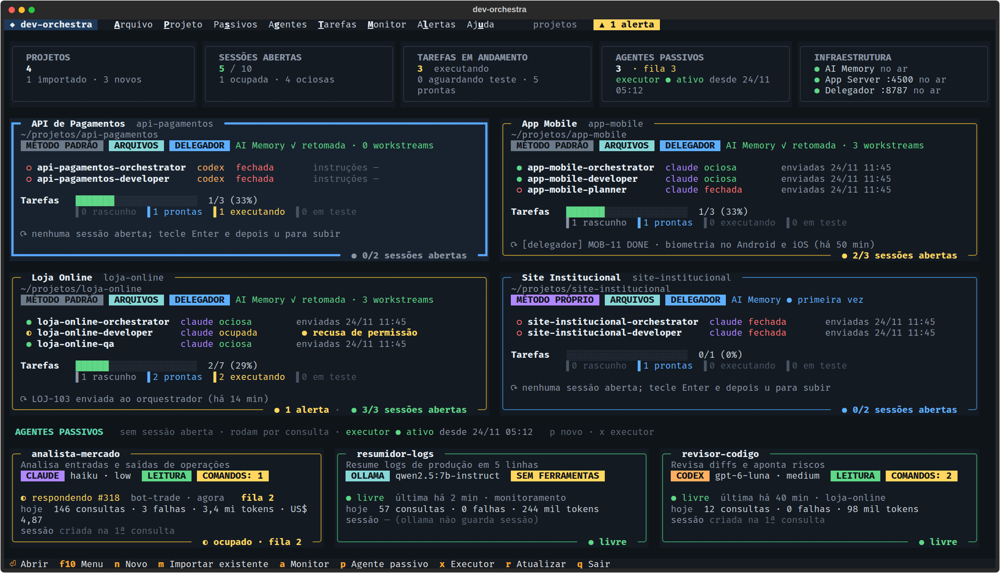

# dev-orchestra (ferramenta)

TUI e CLI do Dev Orchestra: cadastro, subida e retomada de projetos com sessões separadas por papel, comunicação entre as
sessões pelo **delegador MCP** (modo padrão), monitor, alertas e **agentes passivos**. Visão geral, arquitetura e capturas de
tela no [README do repositório](../README.md).

> **Situação:** em uso pessoal, com testes automatizados (`uv run pytest`). O delegador está homologado com **Claude Code**;
> com **Codex** está implementado e a homologação real está pendente.



## O que faz

- **Arquivos do método** criados na pasta do projeto ao cadastrá-lo, sem sobrescrever nada (veja abaixo).
- **Cadastro de projeto** (TUI ou comandos): pasta, papéis (orchestrator, developer, qa, planner e especialistas),
  e para cada papel a CLI (`claude` ou `codex`), modelo e esforço padrão e a assinatura.
- **Tarefas** em arquivos Markdown na pasta do projeto (`.dev-orchestra/tarefas/`), com metadados TOML.
- **Subir e retomar:** imprime um bloco de comandos por terminal, na ordem certa (App Server do Codex, depois cada
  papel), decidindo `--new` ou `--workstream` pelo que o AI Memory já conhece.
- **Identidade dos agentes:** cada agente se chama `[prefixo]-[papel]` (o prefixo é o id do projeto, ou o campo
  `--prefix`). Esse é o nome da sessão (`--name`), do workstream no AI Memory e do agente nas mensagens.
- **Status das sessões:** aberta (ociosa/ocupada), fechada ou desconhecida, a partir de `claude agents --json`,
  do App Server do Codex e de `ai-memory workstreams`, mais a situação do **projeto no AI Memory** (primeira vez ou
  retomada) e se cada agente já **recebeu as instruções**.
- **Envio das instruções** a cada agente com sessão aberta (veja abaixo).
- **Delegador MCP** (padrão em projetos novos e importados): canal único entre as sessões, com permissões por papel,
  estado em SQLite e sessões acordadas por hooks. Sem ele, o transporte é SendMessage (Claude) ou `codex queue` (Codex).
- **Monitor e alertas** do delegador, e **agentes passivos** consultados por outros sistemas pelo MCP.
- **Exportar e importar** a configuração do projeto (subconjunto portátil, para o Git do projeto).

A ferramenta **nunca abre sessões por você**: ela imprime os comandos; depois que você abre as sessões, ela **envia as
instruções** a cada uma.

## Requisitos

- Python 3.11 ou superior e [`uv`](https://docs.astral.sh/uv/).
- Para o status e a retomada: `claude`, `codex` e `ai-memory` no `PATH`. Cada fonte é opcional; se uma falhar, o papel
  correspondente aparece como `desconhecida`.
- Codex: o App Server precisa estar no ar (`codex app-server --listen ws://127.0.0.1:4500`).

## Instalação

```bash
cd tool
uv tool install .          # instala o comando `dev-orchestra` no seu usuário
dev-orchestra --version
```

Atualizar depois de mudar o código: `uv tool install --reinstall .`. Para desenvolver sem instalar: `uv run dev-orchestra ...`.

## Onde ficam os arquivos

| O quê | Onde |
| --- | --- |
| Configuração global (assinaturas, URL do App Server) | `~/.local/share/dev-orchestra/config.toml` |
| Cadastro de cada projeto | `~/.local/share/dev-orchestra/projetos/<id>.toml` |
| Tarefas | `<pasta-do-projeto>/.dev-orchestra/tarefas/*.md` (vão para o Git do projeto) |
| Configuração exportada | `<pasta-do-projeto>/.dev-orchestra/projeto.toml` |
| Arquivos do método | `AGENTS.md`, `roles/`, `docs/`, `templates/`, `.claude/agents/` na pasta do projeto |
| Agentes passivos | `~/.local/share/dev-orchestra/agentes/<id>/` (`agente.toml`, `perfil.md`, `arquivos/`, `sessao.json`) |
| Sessões dos agentes passivos | no armazenamento da própria CLI (Claude: `~/.claude/projects/<pasta do agente codificada>/`) |
| Fila e histórico das consultas | SQLite do delegador (volume Docker `dev-orchestra-delegator-data`) |

A pasta de instalação pode ser trocada com `DEV_ORCHESTRA_HOME`. `dev-orchestra config` mostra os caminhos em uso.

## Arquivos do método no projeto

Ao **cadastrar** (ou importar) um projeto, a ferramenta cria na pasta dele os arquivos que os textos de abertura mandam
os agentes ler: `AGENTS.md`, `roles/*.md`, `docs/PROTOCOL.md`, `docs/MODEL-SELECTION.md`, `docs/ADAPTER-*.md`,
`templates/handoff.md` e `templates/result.md`, mais `.claude/agents/{developer,planner,qa}.md` quando algum papel usa
Claude Code. Regras:

1. O que **não existe** é copiado.
2. Se o projeto **já tem alguns**, só os que faltam são copiados; **nada é sobrescrito**.
3. Se o projeto **já tem um `AGENTS.md` próprio**, ele **não é alterado**. O modelo do contrato vai para
   `.dev-orchestra/contrato/AGENTS.md` e o **texto de abertura do orquestrador** o instrui a incorporá-lo ao
   `AGENTS.md` existente (preservando o conteúdo atual, com os caminhos dos arquivos de referência) e a pedir a sua
   aprovação antes de gravar. A ferramenta considera o contrato incorporado quando o `AGENTS.md` cita `roles/orchestrator.md`.

`dev-orchestra scaffold PROJETO` repete a operação (por exemplo, depois de apagar um arquivo); `--dry-run` só mostra o
que seria criado. Na TUI, a tecla `f` na tela do projeto faz o mesmo. `up` e `resume` avisam quando faltam arquivos.
Para não criar nada ao cadastrar: `projects add ... --no-scaffold`.

Só são copiados os `roles/<papel>.md` dos papéis cadastrados, os `.claude/agents/<papel>.md` dos papéis em Claude Code, os
`ADAPTER-*` das CLIs em uso e `docs/DELEGATOR.md` no modo delegador.

Os arquivos copiados vêm de uma cópia embutida no pacote, mantida igual aos arquivos da raiz deste repositório
(`uv run python scripts/sync_contract.py`; um teste falha se ficarem diferentes). Os links internos dos
`docs/ADAPTER-*.md` para documentos que não são copiados (por exemplo `SETUP.md`) ficam sem destino no projeto.

## Importar um projeto que já existe

Para um projeto que já trabalha com o AI Memory e tem agentes próprios (por exemplo, um projeto com `.claude/agents/` e `.ai-memory.toml` próprios), use a TUI:
na lista de projetos, tecle **`m`**, informe a pasta e confirme. A ferramenta **só lê** a pasta e o AI Memory:

| O que lê | Para quê |
| --- | --- |
| `.ai-memory.toml` e `ai-memory list-projects` / `workstreams` | O projeto e os workstreams que já existem (com o último uso e a CLI vinculada) |
| `.claude/agents/*.md` | As definições de agente do Claude Code (`--agent`) |
| `AGENTS.md` e `docs/**/*dev-orchestra*.md` | Os documentos do método do próprio projeto, que os textos de abertura passam a citar |
| Esses documentos | O board do Trello, se algum o citar (`board **Nome**` ou URL) |

A ferramenta **sugere** o agente de cada papel pelo nome, privilegiando o mais recente (`orquest*`/`orchest*` → orchestrator,
`dev*` → developer, `plan*` → planner, `qa*` → qa; ignora sessões soltas como `codex-2` e `default`) e a CLI pelo histórico
do workstream; uma definição de agente existente indica o Claude Code. Você confirma ou troca cada escolha e informa
modelo, esforço e, se usar, o UUID da thread do Codex (gera `codex resume <UUID>`). Como a TUI é longa, **Ctrl+S**
importa e **Esc** cancela.

O que a importação **preserva e não faz**:

- **Nomes preservados:** o agente (sessão e workstream) mantém o nome existente (`codex-orquestador`, `codex-dev`...),
  então a retomada continua no mesmo workstream. O prefixo `[prefixo]-[papel]` vale só para projetos novos.
- **Método próprio:** nenhum arquivo é copiado (`roles/`, `templates/`...) e o `AGENTS.md` não é tocado. Os textos de
  abertura citam `AGENTS.md` e os documentos que você indicar. Só a pasta `.dev-orchestra/tarefas/` é criada.
- Os comandos de subida usam `--workstream <nome existente>` e `--agent <definição existente>`; `up` e `resume` mostram
  a retomada. Editar o projeto depois (`p`) preserva nome, agente, UUID, método e mapa de listas.

Sem TUI: `dev-orchestra projects scan PASTA` mostra o que foi encontrado e a sugestão; `projects import-existing PASTA --yes`
aceita as sugestões.

### Trazer o Trello para texto local

Em um projeto com fonte de tarefas **Trello**, a tecla **`y`** na tela do projeto (ou `dev-orchestra tasks import-trello
PROJETO`) pede ao **orquestrador** que leia o board pelo conector MCP do Trello da própria CLI dele e grave cada cartão
como um arquivo de tarefa em `.dev-orchestra/tarefas/`. A ferramenta não fala com o Trello; ela gera o arquivo de
instruções `.dev-orchestra/abertura/importar-trello.md` e entrega ao orquestrador uma mensagem curta apontando-o. As
instruções determinam:

- **somente leitura** do Trello e nenhuma tarefa iniciada;
- o **mapa de listas → estado** (editável ao importar; o padrão cobre Backlog, Próxima Sprint, Em desenvolvimento,
  Aguardando testes, Finalizado...), a regra de **ID** (prefixo do título, ou `T-<shortLink>`) e o formato exato do arquivo,
  com `trello` (URL do cartão) e `lista` nos metadados, descrição e checklists preservados como estão;
- **idempotência:** não sobrescrever arquivo existente; listar diferenças e pedir a sua aprovação;
- um **resumo** ao final (criados, já existentes, divergentes).

O Trello continua sendo a fonte oficial do estado: o orquestrador segue atualizando o cartão ao concluir, como hoje. Os
arquivos são cópias de trabalho (o texto do cartão passa por um modelo, então confira o resumo).

## Enviar as instruções aos agentes

Fluxo: (1) cadastrar; (2) `dev-orchestra up` e abrir cada sessão com os comandos; (3) `dev-orchestra send PROJETO`
(ou a tecla `i` na tela do projeto). Para cada agente com **sessão aberta**, a ferramenta:

1. grava as instruções completas em `.dev-orchestra/abertura/<agente>.md` (arquivo gerado, regerado a cada envio);
2. envia uma mensagem **curta** apontando esse arquivo ("Você é X, papel Y. Leia ... e siga as instruções");
3. registra o envio (pasta de instalação, `estado/<projeto>.json`) para não repetir sem você pedir.

| CLI | Como a mensagem chega |
| --- | --- |
| **Codex** | `codex queue` pelo App Server, endereçado pelo **nome** da thread (`[prefixo]-[papel]`). Se existir **uma** thread sem nome e um papel Codex sem thread, a ferramenta a nomeia pelo App Server (`thread/name/set`); com mais de uma, ela não adivinha: use `/rename` |
| **Claude Code** | `SendMessage`, a ferramenta documentada de mensagens entre sessões. Ela só roda dentro de uma sessão Claude, então a ferramenta abre uma sessão auxiliar curta (`claude -p`, Haiku, esforço baixo, nome `dev-orchestra-relay`) que a chama. Custo medido: cerca de US$ 0,006 e 8 s por mensagem. A sessão auxiliar roda numa pasta neutra e com a captura do AI Memory desligada |

Detalhes:

- **Não envia** para sessão fechada, desconhecida ou com erro, nem repete para quem já recebeu. `--again` reenvia com a
  mensagem de **retomada** ("releia suas instruções"). `--dry-run` só mostra o plano; `--role` limita a um papel.
- Sessão **ocupada** recebe a mensagem ao fim do turno atual.
- A sessão que recebe vê a mensagem como vinda de **outra sessão** (não de você); as regras de permissão dela continuam
  valendo, e uma sessão com `crossSessionInbound` em `refuse`/`hold` pode recusá-la ou segurá-la.
- Não escrevemos no socket das sessões Claude: o formato para postar de fora não é documentado.

### Enviar uma tarefa ao orquestrador

Com a tarefa criada, `dev-orchestra tasks send PROJETO ID` (ou `g` na tela do projeto, com a tarefa selecionada) entrega
ao orquestrador, **pelo mesmo canal** das instruções, uma mensagem curta: qual é a tarefa, onde está o arquivo, qual
papel deve executá-la e o que fazer (confirmar objetivo e critérios, recomendar MODEL/EFFORT/MODEL_REASON, **pedir a
sua aprovação e só então delegar**, sem implementar). Se a tarefa for do próprio orquestrador, a mensagem pede que ele
a execute com a sua aprovação. A coluna ENVIADA mostra quando e a quem; não reenvia sem `--again`.

## AI Memory: primeira vez ou retomada

`status`, `resume` e a tela do projeto dizem se o projeto **já existe no AI Memory** (`ai-memory list-projects`) e
quantos workstreams ele tem: "primeira vez" (será criado na primeira sessão) ou "retomada". O nome usado é o
`--ai-memory-project` (padrão: o id). Se a pasta não tem `.ai-memory.toml`, o AI Memory pode deduzir outro nome pelo
remote do Git; confira `ai-memory list-projects` e, se preciso, cadastre com `--ai-memory-project`.

Workstreams antigos, sem prefixo (por exemplo `developer`), não são reconhecidos como retomada: o nome novo cria outro, e
o status avisa que existe um antigo.

## Uso rápido

```bash
# 1. (uma vez) definir assinaturas; --profile é o valor de `ai-memory run --profile`
dev-orchestra subscriptions add claude-pessoal --cli claude --profile pessoal

# 2. cadastrar o projeto
dev-orchestra projects add --id meu-projeto --name "Meu projeto" --path ~/projetos/meu-projeto \
  --role orchestrator=claude,model=sonnet,effort=medium \
  --role developer=claude,model=sonnet,effort=medium,subscription=claude-pessoal

# 3. ver como subir as sessões (ou retomar um projeto em andamento)
dev-orchestra resume meu-projeto        # sessões + tarefas em andamento + últimos resultados + comandos
dev-orchestra up meu-projeto            # só os comandos
dev-orchestra status meu-projeto        # só o status das sessões
dev-orchestra send meu-projeto          # envia as instruções aos agentes com sessão aberta (--dry-run, --again, --role)

# 4. tarefas
dev-orchestra tasks new meu-projeto DEMO-001 --title "Meu primeiro fluxo" --role developer
dev-orchestra tasks list meu-projeto
dev-orchestra tasks set-state meu-projeto DEMO-001 running
dev-orchestra tasks send meu-projeto DEMO-001      # entrega a tarefa ao orquestrador (sessão aberta; --dry-run, --again)

# 5. exportar/importar a configuração (outra máquina)
dev-orchestra export meu-projeto
dev-orchestra import --path ~/projetos/meu-projeto --subscription developer=claude-pessoal
```

`up` e `resume` aceitam `--offline` (não consultam as CLIs nem o AI Memory).

## TUI

A interface segue um visual único em todas as telas (mesma paleta, painéis arredondados, selos e estados coloridos).

- **Projetos:** um **cartão** por projeto, em **2 colunas** (1 coluna se o terminal tiver menos de 110 colunas). Cada
  cartão traz o nome e o id, a pasta, os selos (**MÉTODO PRÓPRIO/PADRÃO**, **TRELLO/ARQUIVOS**), a situação no AI Memory
  (retomada ou primeira vez), os agentes com o estado da sessão (● ociosa, ◐ ocupada, ○ fechada, ? desconhecida) e quando
  receberam as instruções, uma barra de progresso das tarefas com os contadores e a última atividade. A **cor da borda**
  resume a saúde: verde (todas as sessões abertas), amarela (parcial), cinza (nenhuma aberta), azul (projeto novo). No
  topo, uma faixa resume projetos, sessões abertas, tarefas em andamento e a infraestrutura (AI Memory e App Server).
  As setas navegam pela grade e **Enter** abre o projeto; tudo se atualiza sozinho a cada 10 s.
- **Projeto:** faixa com os dados do projeto, **passo a passo** (① Cadastro → ② Sessões → ③ Instruções → ④ Tarefas) com o
  **próximo passo sugerido**, painéis **Agentes** (o detalhe completo do agente destacado aparece abaixo da tabela) e
  **Tarefas**, e **Atividade recente** (envios, importações, mudanças de estado e avisos de tarefas inválidas).
- **Subir/retomar:** um cartão por terminal, com os comandos prontos para copiar.

### Barra de menus e telas do projeto

- **Menu superior:** `Arquivo · Projeto · Agentes · Tarefas · Ajuda`. Abra com **F10** (menu Arquivo), **Alt + letra
  sublinhada** (Alt+A, P, G, T, U) ou clicando no nome; ←/→ trocam de menu e Esc fecha. Cada item mostra a sua tecla de
  atalho, e só aparecem os itens que existem na tela atual. **F1** lista as teclas e **F2** mostra a legenda de cores.
- **Abas do projeto** (teclas **1**, **2**, **3** ou clique): **Visão geral** (tabelas + atividade recente), **Agentes**
  (um cartão por agente, em lista vertical: papel, CLI, modelo e esforço, sessão, instruções, AI Memory e tarefa atual;
  Enter abre o detalhe e `Shift+I` envia as instruções só àquele agente) e **Tarefas** (quadro **kanban**: Rascunho,
  Prontas, Executando, Em teste, Concluídas e, se houver, Com problema; setas navegam, Enter ou clique abre a tarefa e
  `g` / `s` enviam ao orquestrador ou mudam o estado).
- **Cartões do projeto com a mesma altura:** em cada linha da grade todos ficam com a altura do maior.
- **Atualização automática a cada 3 s** (sessões, tarefas editadas no disco pelo orquestrador e atividade); voltar de
  outra tela ou teclar `r` atualiza na hora. O cursor e o foco não se movem durante a atualização.

`dev-orchestra` (sem argumentos) abre a TUI.

| Tela | Teclas |
| --- | --- |
| Projetos | `n` novo, `m` importar projeto existente, `Enter` abrir, `d` remover cadastro, `r` atualizar, `q` sair |
| Projeto | `u` subir/retomar, `i` enviar instruções, `g` enviar a tarefa selecionada ao orquestrador, `y` importar os cartões do Trello, `t` nova tarefa, `s` estado da tarefa, `e` exportar config, `f` completar arquivos do método, `p` editar, `r` atualizar status, `Esc` voltar. O status se atualiza sozinho a cada 10 s |
| Subir/retomar | `c` copia a seleção (ou o plano todo), `1`-`9` copiam só os comandos do terminal N, `x` sai e imprime o plano no terminal, `Esc` voltar |
| Formulários | `Tab` navega, **`Ctrl+S` salva**, `Esc` cancela; em terminais pequenos o formulário rola |

### Copiar texto na TUI

A TUI captura o mouse, então a seleção normal do terminal não funciona sozinha. Opções, da mais simples:

1. **`x`** na tela de subida: sai da TUI e imprime o plano no terminal normal; aí você seleciona e copia como
   sempre. Os comandos saem sem prefixos (`$`), prontos para colar.
2. **Segure `Shift` e arraste o mouse** (seleção do próprio terminal) e use `Ctrl+Shift+C`.
3. **`c`** copia pela ferramenta do sistema, se houver uma instalada (`wl-copy` no Wayland: `sudo apt install wl-clipboard`;
   `xclip` ou `xsel` no X11). Sem ela, a ferramenta tenta o escape OSC 52 do terminal (nem todos aceitam, por exemplo
   os baseados em VTE) e salva o texto em `ultimo-plano.txt` na pasta de instalação.

## Limites conhecidos

- **Codex com o delegador** e os agentes passivos em Codex, OpenCode, Ollama e "comando" estão implementados e cobertos
  por testes automatizados, mas ainda não foram homologados com contas e sessões reais.
- Sem o delegador, o **transporte misto** (por exemplo, Claude orquestra e Codex executa) não é suportado: o modo antigo
  usa um único transporte (SendMessage ou `codex queue`). Com o delegador, o canal é o mesmo para qualquer CLI.
- O status do Claude Code vê só as **sessões interativas desta máquina** (`claude agents --json`, formato observado e
  não documentado oficialmente). O do Codex exige o App Server no ar.
- O executor dos agentes passivos ainda não pausa a fila quando a conta da CLI atinge o limite de uso: as consultas
  falham até o limite passar.
- Centro de custo (consumo por projeto e agente num painel) é trabalho futuro; os dados já ficam no delegador.

## Desenvolvimento

```bash
cd tool
uv sync
uv run pytest -q
uv run ruff check src tests && uv run ruff format --check src tests
uv run python scripts/sync_contract.py   # depois de mudar AGENTS.md, roles/, docs/ ou templates/ na raiz do repositório
```

Estrutura: `src/dev_orchestra/core/` (modelos, TOML, tarefas, comandos, status; sem dependência da TUI),
`src/dev_orchestra/tui/` (telas Textual) e `src/dev_orchestra/cli.py` (comandos).


## Delegador (MCP)

O delegador é um serviço que guarda, confere e entrega as mensagens entre as sessões do projeto (orquestrador e workers):
aplica a tabela de permissões por papel, guarda o estado de execução das tarefas em SQLite e acorda as sessões ociosas **sem
levar conteúdo** (o conteúdo só sai por `receive`). Contrato para os agentes: `docs/DELEGATOR.md`. Autohomologação com Claude
Code: `docs/HOMOLOGACAO-DELEGADOR-CLAUDE.md`. **Codex: implementado, ainda não homologado.**

```bash
uv tool install --reinstall './tool[delegator]'      # ou, no checkout: cd tool && uv sync --extra delegator
dev-orchestra delegator docker up                  # container (rede do host, 127.0.0.1:8787, volume com o SQLite)
dev-orchestra delegator install MEU-PROJETO        # servidor MCP + permissões + hooks + definições de agente do Claude
```

Depois ative o modo no cadastro (`delegador = true` ou a caixa na edição do projeto na TUI), rode `dev-orchestra scaffold` (cria
`docs/DELEGATOR.md`; num `AGENTS.md` já existente o orquestrador é instruído a incorporar a regra, com a sua aprovação) e abra as
sessões com os comandos de `dev-orchestra up` (levam `DEV_ORCHESTRA_AGENT=<nome>`, que o listener usa para saber quem é a sessão).

| Comando | Para quê |
| --- | --- |
| `delegator docker up / down / status / logs` | instala e controla o container |
| `delegator install PROJETO [--exe ..] [--scope local\|project\|user] [--dry-run]` | MCP, permissões, hooks e `tools:` das definições de agente |
| `delegator status PROJETO` | sessões (viva, sem sinal, substituída) e tarefas |
| `delegator events PROJETO` | histórico (registro, delegar, receber, resultado, pergunta, cancelamento) |
| `delegator cancel PROJETO TAREFA [--reason ..]` | a pessoa cancela uma delegação (o worker é avisado) |
| `delegator profile PROJETO PAPEL` | reenvia o perfil às sessões vivas |
| `delegator serve` | roda o servidor no terminal, sem Docker (desenvolvimento) |

Na TUI: a faixa **Infraestrutura** mostra o delegador; o cartão do projeto ganha o selo **DELEGADOR**; os cartões de agente
mostram o registro e o último sinal; a atividade inclui os eventos do delegador; `x` (menu Tarefas) cancela a delegação da tarefa
selecionada.

Ferramentas MCP (inglês, como decidido): `register_session`, `heartbeat`, `delegate`, `receive`, `report`, `ask`, `answer`,
`cancel_task` e `project_status`. Quem pode chamar o quê: orquestrador (`delegate`, `answer`, `cancel_task`), worker (`report`
e `ask`, só da própria tarefa), todos (`register_session`, `heartbeat`, `receive`, `project_status`; o worker só vê a própria tarefa).

Como a sessão é acordada: no Claude Code, hooks `asyncRewake` (`SessionStart`, `UserPromptSubmit`, `PostToolUse`, `Stop` e
`Notification`) rodam `python -m dev_orchestra.delegator listen`, que só lê a contagem no delegador e sai com código 2 (acorda)
quando há mensagem; um listener por agente, até 59 min. No Codex, o delegador inicia um turno curto pelo App Server (`turn/start`).
Limites conhecidos na homologação: veja o documento acima.


## Monitor de atividade (tecla `a`, menu Monitor)

Projetos à esquerda e a linha do tempo à direita: hora, projeto, tipo, de → para, tarefa, estado, tentativa, resumo e latência
até a sessão receber. A faixa do topo mostra o delegador, as sessões vivas, tarefas em execução, perguntas abertas, mensagens
pendentes, recusas do dia e a latência média, com filtros clicáveis. Embaixo, o detalhe do evento selecionado (texto completo da
mensagem e linha do tempo da tarefa). Teclas: `←` `→` projeto, `f` alterna filtros (todos, atenção, fluxo), `p` pausa, `/` busca,
`c` copia, `t` abre a tarefa, `x` cancela a delegação. O conteúdo vem de outros agentes: é exibido como texto, nunca executado.

## Alertas (F3, menu Alertas)

Avisam quando algo **para ou desvia o trabalho dos agentes** e precisa da pessoa.

| Gravidade | Tipo | Como é detectado |
| --- | --- | --- |
| ▲ crítico | aguardando permissão; pergunta para a pessoa | hooks do Claude (`PermissionRequest`, `Notification`, `PreToolUse` de `AskUserQuestion`) + o status ao vivo `waiting` do `claude agents` |
| ▲ crítico | aguardando você (sessão esperando, sem hook para dizer o quê) | status ao vivo `waiting` |
| ▲ crítico | turno interrompido (limite de uso, erro de API ou de autenticação) | hook `StopFailure` |
| ● atenção | pergunta de worker sem resposta (> 5 min); tarefa parada (> 10 min); delegada e não recebida (> 2 min); sessão fechada com tarefa; recusa de permissão; delegador fora do ar | delegador |
| ○ info | concluída, aguardando a conferência do orquestrador (> 2 min) | delegador + arquivo da tarefa |

- **Onde aparece:** sino com a contagem na barra de menus (todas as telas), borda e marca nos cartões dos projetos, aviso temporário e a
  **central de alertas** (lista, detalhe com "o que fazer", regras). Ações: reconhecer (`a`), silenciar 30 min (`s`), silenciar o
  tipo (`m`), ir ao agente (`Enter`), abrir no monitor (`o`), cancelar a tarefa (`x`) e configurar (`c`).
- **Som e notificação do sistema (Linux):** crítico = som de alarme + notificação crítica; atenção = som de mensagem + notificação normal;
  info = só a TUI. Usa `notify-send` e `pw-play` (ou `paplay`, ou `canberra-gtk-play`; sem player, o sino do terminal). O som some no horário de
  silêncio (padrão 22:00–07:00), mas a notificação continua. Crítico sem resposta repete a cada 5 min (até 3 vezes). Tudo configurável
  (`c` na central; seção `[alertas]` do `config.toml`) e testável: `dev-orchestra alerts test`.
- **Com a TUI fechada (opcional, desligado por padrão):** `dev-orchestra alerts install-service` grava a unidade `systemd --user`
  do watcher (`dev-orchestra alerts watch`); ele usa o mesmo estado (`alertas.json`, com trava), então nada é avisado duas vezes.
- **Hooks de alerta:** `dev-orchestra delegator install PROJETO` os instala (assíncronos: nunca seguram o diálogo de permissão); as
  sessões abertas antes disso precisam ser reabertas para carregá-los. Cada payload recebido é registrado em
  `<instalação>/listeners/sinais.log` (diagnóstico). Sem hooks, o status ao vivo ainda gera o alerta "aguardando você".
- CLI: `alerts list [--all]`, `alerts test [--only crítico|atenção|info]`, `alerts watch [--once]`, `alerts install-service [--print]`.

## Formulários, sessões adotadas e perfis por IA

- **Criar/editar e importar** (menu Arquivo): cartões numerados com um *resumo ao vivo* (agentes `prefixo-papel`, o que será
  criado sem sobrescrever, comandos de subida, avisos). **Pasta:** `Tab` completa, `Ctrl+O` abre o navegador (marcadores GIT/AGENTS.md/PYTHON,
  recentes, `Ctrl+H` mostra ocultos). **Modelo:** digite ou `F2` para o catálogo lido da própria CLI (`codex debug models`,
  `opencode models`, API do Ollama; o Claude não lista modelos: aliases do `--help` e ids conhecidos). **Esforço:** chips que seguem
  o modelo e a CLI (`claude --help`, `codex`). `Ctrl+S` salva.
- **Sessão existente do Claude como papel** ("Adotar sessão existente…"): lista as sessões da pasta (título, tamanho, última atividade, modelo;
  as abertas em outro terminal não podem ser adotadas). Por padrão é usada uma **cópia**, criada **ao salvar o cadastro** (a ferramenta copia o transcrito com um id novo, sem abrir o
  Claude nem gastar chamada; a original nunca é tocada). A subida passa a ser `ai-memory run --new <agente> claude --resume <cópia> --name <agente> …`
  na primeira vez e `ai-memory run --workstream <agente> claude …` nas seguintes (o ai-memory retoma a cópia). Motivo da cópia prévia: o
  `ai-memory run` guarda como sessão do workstream o id passado em `--resume`; com `--fork-session` ele guardaria o da ORIGINAL e a retomaria
  (alterando-a) nas subidas seguintes (validado com o ai-memory 3.4.6). Sem a opção de cópia, o workstream continua a sessão original.
  Sessões com dezenas de MB custam contexto/tokens ao retomar: avalie com o tamanho mostrado.
- **Permissões por papel:** *somente leitura* (`--disallowedTools Edit Write NotebookEdit`) ou *plan* (`--permission-mode plan`).
- **Perfis por IA** (aba Agentes, tecla `n`, menu Agentes → "Novo perfil do agente (IA)"): você descreve o que o papel deve fazer; Claude
  (`claude -p`, só leitura), Codex (`codex exec -s read-only`), OpenCode (`opencode run`), Ollama (HTTP local) ou um comando
  próprio (`gerador_comando` no `config.toml`; Kimi entra por aí) escreve um **rascunho**. Você revisa, edita e só então salva:
  `<projeto>/.dev-orchestra/perfis/<papel>.md` (fonte, vai para o Git) e `<instalação>/perfis/<projeto>/<papel>.md` (o que o delegador lê).
  Opcionalmente cria `.claude/agents/<papel>.md` com `tools:` restrito (não sobrescreve). O contexto enviado é o `AGENTS.md`, um índice de
  `docs/` e, se marcado, os nomes em `data/`.
  CLI: `profiles providers|list|show|sync|generate` (`generate` só grava com `--save`).
- **Papéis especialistas** (ex.: `analyst`): no formulário, "＋ Adicionar papel especialista" cria um cartão completo (CLI, modelo, esforço,
  permissões, sessão adotada, **Criar perfil com IA…**) e "Remover papel" o tira. O resumo avisa quando um modelo não está no catálogo
  da CLI (ex.: `Opus 5.5` não é aceito pelo `--model`; use `opus` ou `claude-opus-5-5`).
- **Preparar o delegador** (Projeto → "Preparar delegador", tecla `l`; abre sozinho ao ligar o modo delegador): mostra cadastro, container,
  serviço e hooks/agentes/MCP do projeto, e resolve com botões ("Subir o serviço", "Instalar no projeto"). Depois, reabra as sessões e reenvie
  as instruções (`Shift+R`).
- **Reenviar** (`Shift+R` instruções, `Shift+G` tarefa): também é oferecido ao apertar `i`/`g` quando já foi enviado, com confirmação.
- **Remover um agente** (aba Agentes → `Shift+D`, menu Agentes, botão "Remover agente…" no cartão do formulário, ou
  `dev-orchestra agents remove PROJETO PAPEL [--yes]`, que sem `--yes` só mostra o plano): mostra o que será apagado e pede
  confirmação. **Apaga** o papel do cadastro, o perfil (no projeto e na instalação), as instruções de abertura geradas, a
  definição de agente gerada pela ferramenta (marcada com `<!-- gerado por dev-orchestra -->`), o registro de envios do agente e o papel
  na configuração exportada. **Não toca** em `roles/<papel>.md`, em definições de agente escritas à mão, nas tarefas (avisa quantas apontam para
  o papel), no AI Memory nem no histórico do delegador. Uma sessão aberta do agente não é fechada (o aviso pede que você a feche).

## Agentes passivos (auxiliares chamados pelo MCP)

Um **agente passivo** é um auxiliar que **não fica com sessão aberta** e **não pertence a um projeto**: qualquer sistema (um bot,
a sessão de outro projeto, um script) consulta pelo MCP do delegador informando **só o id do agente**. O delegador
guarda o pedido numa fila; o **executor** (no host, onde estão as CLIs) roda a CLI do agente uma vez, devolve a resposta com o uso
de tokens e encerra. Quem consulta não sabe qual CLI respondeu, e todo consumo fica registrado (base do centro de custo).

- **CLIs**: Claude (`claude -p --resume <sessão> --output-format json`), Codex (`codex exec resume`, não homologado), OpenCode
  (`opencode run --session`), Ollama (HTTP, sem sessão: perfil e arquivos pequenos vão no pedido) e "comando" (qualquer programa que
  leia o pedido no stdin, para Kimi e afins).
- **Sessão própria**: a pasta do agente é o diretório de trabalho da CLI, então a sessão nunca se mistura com as dos projetos. A primeira
  consulta cria a sessão; as seguintes usam `--resume`. "Recomeçar a cada N" limita o crescimento do histórico. No Claude também dá para
  **adotar uma sessão existente** (é copiada para a pasta do agente; a original fica intacta).
- **Perfil** (`perfil.md`): instruções e **formato de resposta**. No Claude vai por `--append-system-prompt-file` a cada consulta (editar
  vale na próxima). **Arquivos de consulta** em `arquivos/`.
- **Permissões** (viram flags; o texto do perfil não impede nada): ler, escrever, comandos (só os prefixos listados, ou qualquer um), web,
  MCPs do usuário e configurações do usuário. Por padrão o Claude roda **sem** os MCPs (`--strict-mcp-config`) e **sem** o
  `~/.claude/settings.json` (`--setting-sources project,local`: os hooks do ai-memory não criam um projeto por agente). O que não está
  liberado é negado (`--disallowedTools`).
- **Fila**: uma consulta por vez por agente; agentes diferentes rodam em paralelo. Consulta presa em execução (executor caiu) volta para
  a fila depois do tempo limite.

Na TUI: a tela inicial tem a seção **Agentes passivos** (cartões com estado, fila, consultas e tokens do dia) e o indicador do topo;
`p` cria, `x` liga/desliga o executor em segundo plano, Enter abre o agente (consultas, detalhe com pedido/resposta/uso, configuração,
eventos; `t` testa uma consulta pelo MCP, `e` edita, `c` cancela uma pendente, `y` copia a resposta, `f` abre os arquivos, `Shift+D`
remove). Menu **Passivos** (Alt+S).

```bash
dev-orchestra passive add analista-trade --cli claude -m sonnet -e high -d "Analisa entradas e saídas" \
    --allow-command "sqlite3 -readonly" --dir ~/projetos/meu-bot/data
dev-orchestra passive run                          # executor (ou: passive start / passive stop, em segundo plano)
dev-orchestra passive send analista-trade "Par SUI/USDT, RSI 41→58… entrar?" --origin meu-bot
```

| Comando | Para quê |
| --- | --- |
| `passive list` / `show ID` | agentes e como cada consulta roda (a linha de comando exata) |
| `passive add ID [--cli --model --effort --timeout --reset-every --write --allow-command --any-command --web --mcps --user-settings --dir --profile-file --adopt-session PASTA:SESSAO --force]` | cria ou substitui |
| `passive remove ID [--sessions] [--yes]` | sem `--yes` só mostra o plano; o histórico no delegador fica |
| `passive send ID TEXTO [--file] [--origin] [--no-wait] [--json]` | consulta **pelo MCP**, como qualquer consumidor |
| `passive result N` / `passive consults [ID]` | estado de uma consulta / consultas recentes |
| `passive run [--once] [--parallel N]` / `start` / `stop` | executor |

Ferramentas MCP: `list_agents`, `consult(agent_id, instruction, origin)` e `consult_result(consult_id)`. Um cliente de exemplo, só com
a biblioteca padrão, para usar em outro sistema: `examples/consultar_agente_passivo.py`.

**Atualizar o delegador**: o container roda uma cópia do código. Depois de atualizar a ferramenta, `dev-orchestra delegator docker up`
avisa se a imagem está desatualizada e `dev-orchestra delegator docker up --rebuild` reconstrói e recria o container (reinicia o serviço
por alguns segundos; o estado fica no volume).

